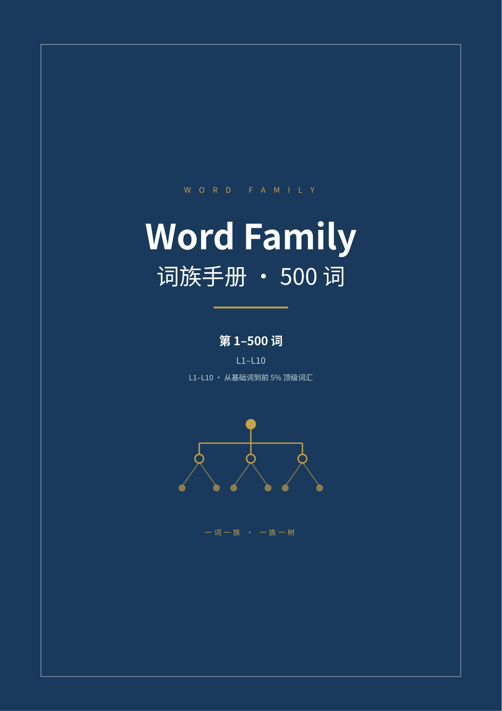
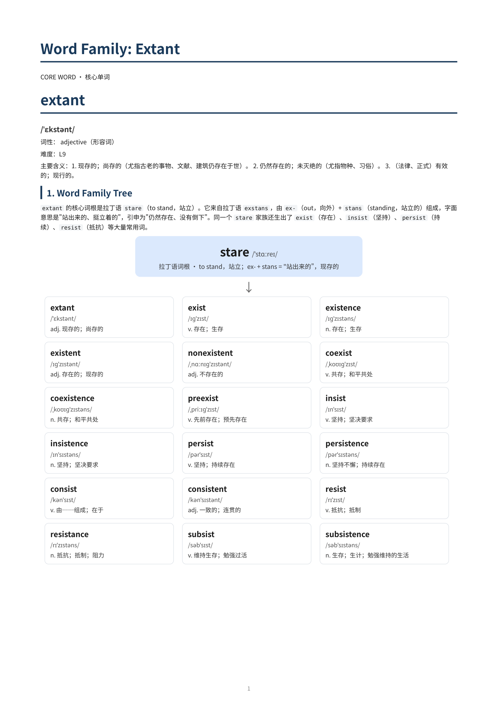
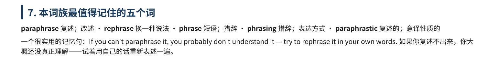

# Word Family 500 词 · 词族手册

一词一族，一族一树。500 个英语单词，用词族的方法讲透。

One word, one family, one tree. 500 English words taught the word-family way.
英文版介绍见 [README_EN.md](README_EN.md)。

## 预览

**封面**

**目录（第 1–500 词）**

**词条示例 · paraphrase（词族树 + 两个最重要的意思）**

**词条示例 · extant（18 张词族卡片）**

## 每个词长什么样 · 以 paraphrase 为例

**1 · 词族树：词根在上，三列展开**

**2 · 两个最重要的意思：搭配 + 例句**

**3 · 高频搭配：12 个常用搭配**

**4 · 近义词辨析：8 个近义词**

**5 · 实用表达：5 个能直接用的表达**

**7 · 五个必记词 + 一句记忆句**

## 这本书是什么

这不是一本单词表，而是一本按**词族**编排的词汇手册。全书 500 词，分 L1–L10 十个级别，每级 50 词，从 60–70% 成年人都认识的基础词，一直爬到前 5% 才用的顶级词汇。

- **体量**：500 词，1,132 页（A3），每个词 2–3 页
- **词族树**：全书 5,266 张词族卡片，平均每个词生出 10.5 个家族成员
- **配套**：每个词都有 Markdown 原稿，可直接在线读；每天 100 词共 5 册 PDF；全书合订本见 [Releases](https://github.com/jacknnnbauer/word-family-500/releases) 下载

## 每个词怎么讲（7 个部分）

1. **核心单词**：音标（美式）、词性、含义
2. **Word Family Tree 词族树**：词根在上，三列展开——一个词根，生出一族词
3. **两个最重要的意思**：搭配 + 例句，一次讲透最常用的两个义项
4. **高频搭配**：12 个常用搭配
5. **近义词辨析**：8 个近义词，怎么分、哪里容易错
6. **实用表达**：5 个能直接用的表达
7. **五个必记词 + 一句记忆句**：走的时候带走五个词，一句话记住

每册第 2 页是目录（编号 / 单词 / 音标 / 难度），全书目录列出全部 500 词。

## 为什么值得读

- **背一个词，记住一族**：词根相同的一串词一起记，记得牢、用得上。孤立背单词最容易忘，词族是最省力的记法。
- **有梯度，能爬坡**：L1 从最基础的词开始，L10 到前 5% 的顶级词汇，十级台阶，一级一级往上走，不会一上来就劝退。
- **每个词都讲到能用为止**：发音、词根、搭配、辨析、表达、记忆，七个角度加工一遍——不是看过就算，而是看完就能开口用。
- **诚实，不编造**：词族只收真实派生词；没有直接派生词的词，会如实说明词根来源，不硬凑。

## 怎么用

- 想系统学：按 L1 → L10 顺序，每天 100 词，5 天走完。
- 想查词：直接在 `words/` 里按词名找 Markdown，或翻全书目录。
- 想打印：A3 排版，每词 2–3 页，适合打印出来慢慢看。

## 文件

- `words/`：500 个词的 Markdown 原稿
- `pdf/`：5 册日册 PDF（每天 100 词）
- 全书合订本（1,132 页）：见 [Releases](https://github.com/jacknnnbauer/word-family-500/releases) 下载

## License

MIT
