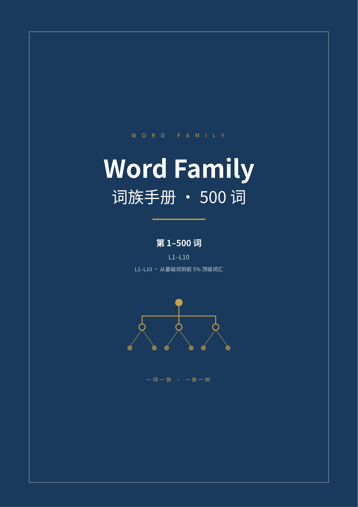
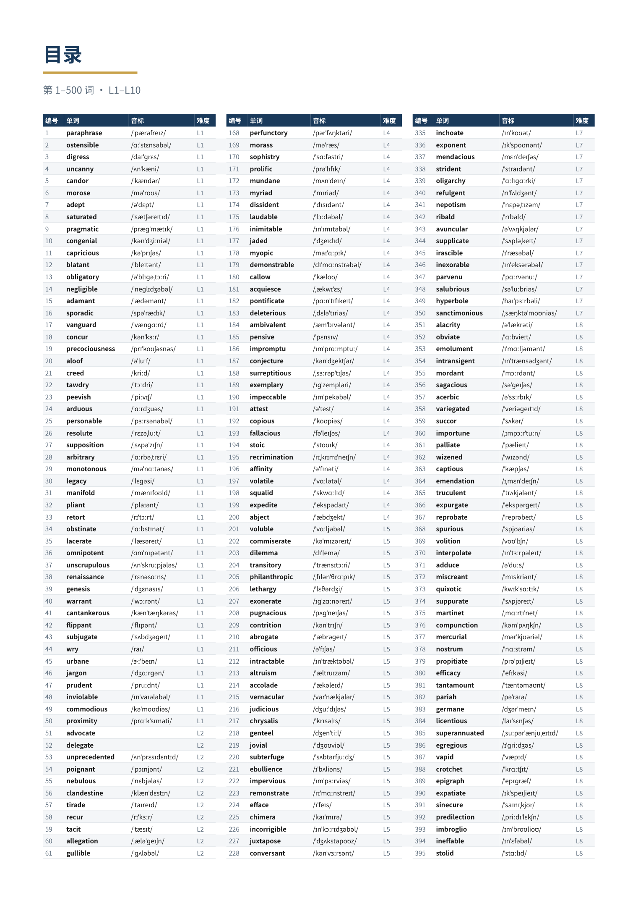
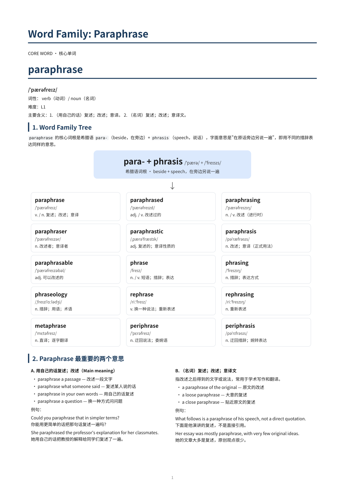
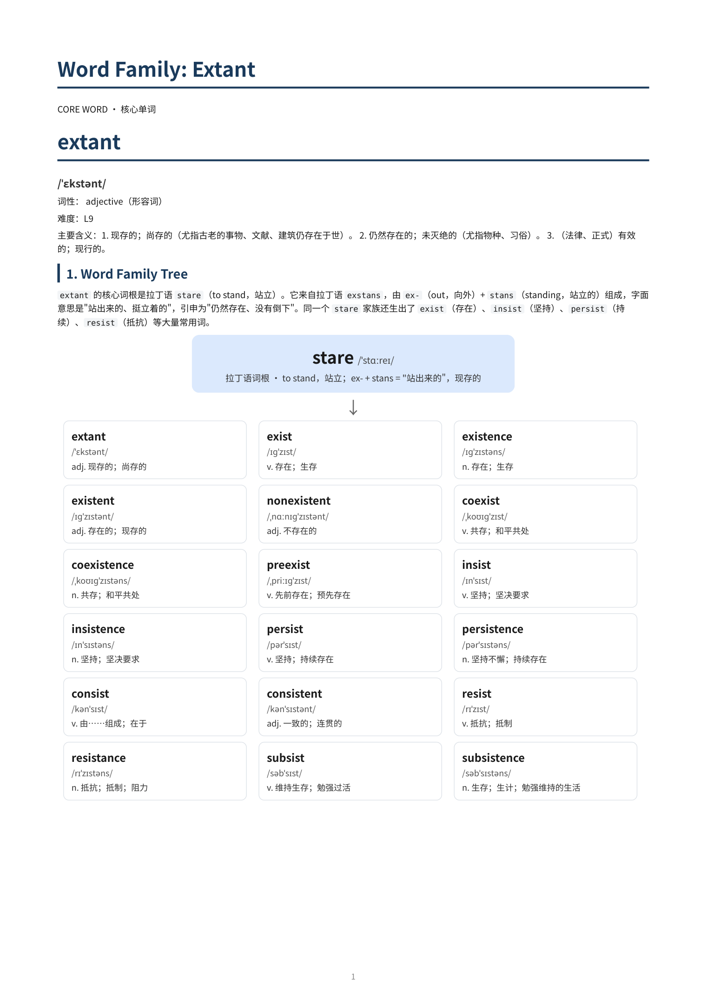
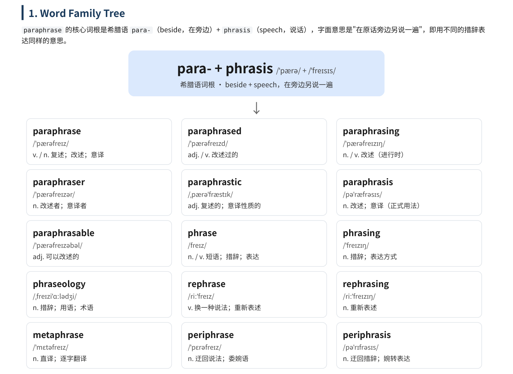
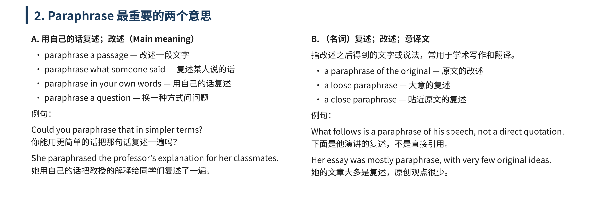
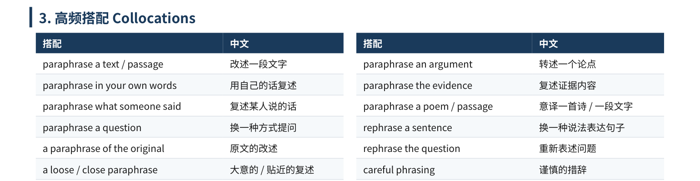
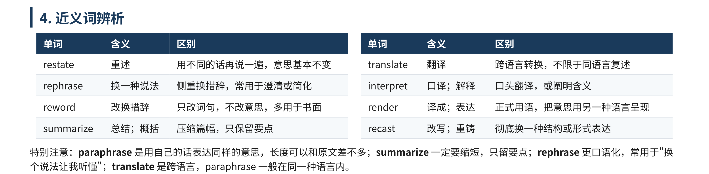
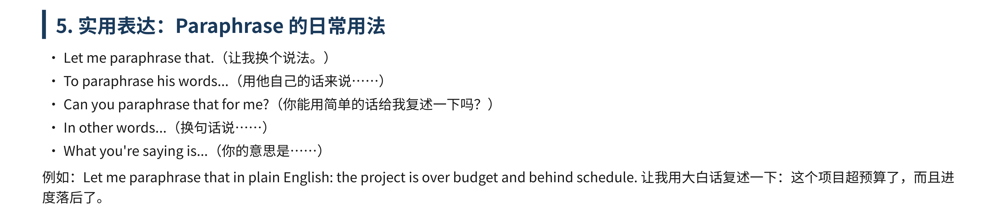
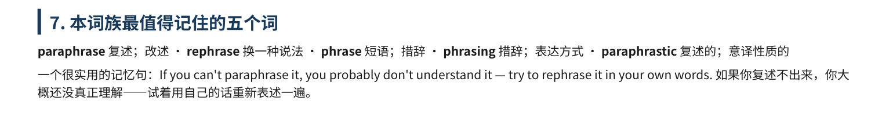

# Word Family 500

One word, one family, one tree. 500 English words taught the word-family way.

中文版介绍见 [README.md](README.md)。

## What this book is

Not a word list — a vocabulary handbook organized by **word family**. 500 words across ten levels (L1–L10), 50 words per level, from words 60–70% of adults know to words only the top 5% use.

- **Scale**: 500 words, 1,132 pages (A3), 2–3 pages per word
- **Family trees**: 5,266 family cards across the book — about 10.5 relatives per word on average
- **Formats**: Markdown source for every word (readable online), five daily volumes of 100 words each as PDF, and the complete book in [Releases](https://github.com/jacknnnbauer/word-family-500/releases)

## Levels at a glance

Ten levels, 50 words each, climbing one step at a time:

| Level | Words | What it covers | Examples |
| --- | --- | --- | --- |
| L1 | 1–50 | Basic words known to 60–70% of adults | paraphrase, ostensible, digress |
| L2 | 51–100 | Advanced synonyms | advocate, delegate, unprecedented |
| L3 | 101–150 | Mid-range words | defray, taciturn, terse |
| L4 | 151–200 | High-end words | provident, impute, astute |
| L5 | 201–250 | 75th-percentile words | voluble, commiserate, dilemma |
| L6 | 251–300 | Greek / Latin roots | legerdemain, puerile, complicity |
| L7 | 301–350 | Advanced words | redress, anomalous, obsequious |
| L8 | 351–400 | Executive / professional level | alacrity, obviate, emolument |
| L9 | 401–450 | Rare but useful words | prolix, apocryphal, cupidity |
| L10 | 451–500 | Top 5% words | jejune, paucity, minatory |

## The five volumes

100 words a day, one volume a day, five days to finish the book:

| Volume | Words | Levels | Pages |
| --- | --- | --- | --- |
| Volume 1 | 1–100 | L1–L2 | 205 |
| Volume 2 | 101–200 | L3–L4 | 275 |
| Volume 3 | 201–300 | L5–L6 | 208 |
| Volume 4 | 301–400 | L7–L8 | 240 |
| Volume 5 | 401–500 | L9–L10 | 210 |
| **Complete book** | **1–500** | **L1–L10** | **1,132** |

## How each word is taught (7 parts)

1. **Core word**: American IPA, part of speech, meaning
2. **Word Family Tree**: the root on top, three columns branching out — one root grows a whole family
3. **Two most important meanings**: collocations + example sentences, the two senses you'll actually use
4. **High-frequency collocations**: 12 common pairings
5. **Near-synonym distinctions**: 8 close words, how they differ, where people go wrong
6. **Practical expressions**: 5 ready-to-use phrases
7. **Five must-remember words + one memory sentence**: leave with five words and one sentence that locks them in

Page 2 of each volume is a contents list (number / word / IPA / level); the complete book lists all 500.

Each word usually takes 2 pages, 3 when the content needs it — nothing is trimmed to fit. Family cards average 10.5 per word; the two biggest families, extant and putative, have 18 cards each.

## Why it's worth reading

- **Learn one word, keep a family**: words sharing a root are learned together — they stick, and you can actually use them. Isolated words are the fastest to forget; families are the cheapest way to remember.
- **A real ladder**: ten levels from the most basic words to the top 5%, one step at a time — no cliff at the start.
- **Taught until usable**: pronunciation, roots, collocations, distinctions, expressions, memory — seven angles on every word, so you finish a word able to use it, not just having seen it.
- **Honest, no invented words**: families include only real derivations; where a word has no direct derivatives, the book says so and traces the root instead of padding the tree.

## Who it's for

- English learners moving from good enough to advanced: climb L1 → L10, 100 words a day, five days to finish.
- Anyone who keeps forgetting memorized words: a root that ties a family together holds far better than isolated words.
- Anyone who wants one word's family, collocations, and near-synonym distinctions in one place: use the contents or find the word in `words/`.

## How to use it

- Study in order: L1 → L10, 100 words a day, five days to finish.
- Look up a word: find its Markdown in `words/`, or use the complete book's contents.
- Print it: A3 layout, 2–3 pages per word, made to be read slowly on paper.

## Files

- `words/`: Markdown source for all 500 words
- `pdf/`: five daily volumes (100 words each)
- Complete book (1,132 pages): download from [Releases](https://github.com/jacknnnbauer/word-family-500/releases)

## Preview

**Cover**

**Contents (words 1–500)**

**Sample entry · paraphrase (family tree + two most important meanings)**

**Sample entry · extant (18 family cards)**

## Inside a word entry · paraphrase as an example

**1 · Word Family Tree: root on top, three columns**

**2 · Two most important meanings: collocations + examples**

**3 · High-frequency collocations: 12 common pairings**

**4 · Near-synonym distinctions: 8 close words**

**5 · Practical expressions: 5 ready-to-use phrases**

**7 · Five must-remember words + one memory sentence**

## License

MIT
